# TechCart: Laptops, PC Parts & Accessories E-commerce

TechCart is a full-stack e-commerce website for computers, built with **Python / Django** for a Python programming assignment. It sells laptops, gaming laptops, 2-in-1s, MacBooks, monitors, PC components (processors, motherboards, memory, graphics cards, storage, power supplies, cases) and accessories, 69 real-brand products in 17 categories, and has a **PC builder** that checks parts are compatible.

Customers can browse, search and filter products, build a custom PC, manage a cart, and check out with **cash on delivery**. Admins manage products, stock and order status. Everything is also available through a **REST API** (Django REST Framework) with interactive Swagger documentation.

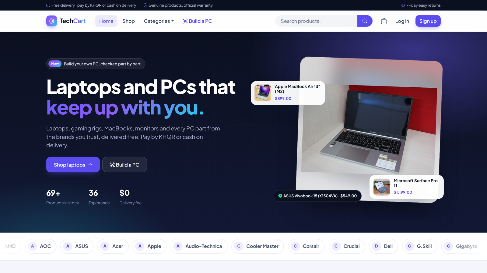

---

## Features

**Customer**
- Register, log in, log out
- Browse all products or one category
- Search by name, brand or description
- Filter by price range and "in stock only", and sort by price, name or newest
- Product detail page with stock status, a full specification table and related products
- **PC builder** (`/build-pc/`): pick a processor, motherboard, memory, graphics card, storage, power supply and case.
  It checks CPU socket, memory type (DDR4/DDR5), motherboard size vs. case, CPUs without graphics,
  and power-supply wattage, marks parts that won't fit, and adds the whole build to the cart.
  Quick-start builds: `/build-pc/?preset=budget` and `/build-pc/?preset=highend`
- Cart: add items, change quantities, remove items (updates live through the API)
- **KHQR payment**: choose "Pay now with KHQR" at checkout to get a QR code (EMVCo/KHQR format, with the
  order amount and a CRC checksum) and a 15-minute timer. "I have paid" confirms the payment (demo: no
  money moves) and shows a **printable receipt** (print or save as PDF) with a verification QR code.
  Cash on delivery is still available and is marked paid when the order is delivered.
  To receive real KHQR payments, set `TECHCART_KHQR_ACCOUNT` to your Bakong account ID and add a
  bank/Bakong transaction check in `store/payments.py` (`confirm_payment`).
- Checkout with cash on delivery, with form validation
- Order history, order progress tracker, and cancelling a pending order

**Admin (staff users)**
- Dashboard with revenue, orders, active products and low-stock alerts
- Create, edit and delete products (with optional image upload)
- Update stock levels directly from the product table
- View all orders, filter by status, and update order status
- Cancelling an order automatically returns its items to stock
- Full Django admin at `/admin/`

**API**
- REST endpoints for auth, categories, products (with specs), cart and orders
- PC builder: `GET /api/pc-builder/parts/`, `POST /api/pc-builder/check/` and
  `POST /api/pc-builder/add-to-cart/` with body `{"parts": {"cpu": 1, "motherboard": 5, ...}}`
- Payments: `POST /api/orders/` with `"payment_method": "qr"` or `"cod"`, then
  `GET /api/orders/{id}/payment-qr/`, `POST /api/orders/{id}/confirm-payment/` and `GET /api/orders/{id}/receipt/`
- Token authentication and session authentication
- Permissions: public read-only catalogue; customers only see their own cart and orders; only admins can change products, stock and order status
- Swagger UI at `/api/docs/` and OpenAPI schema at `/api/schema/`

**Design**
- Responsive layout for mobile and desktop (Bootstrap 5)
- Clear navigation, breadcrumbs, empty states, toasts and inline form errors

---

## Tech stack

| Part | Technology |
|---|---|
| Frontend | HTML, CSS, Bootstrap 5, Bootstrap Icons, JavaScript (Fetch API) |
| Python backend | Django |
| API | Django REST Framework + drf-spectacular (Swagger) |
| Database | SQLite |
| Tests | Django test runner (31 tests) |

Bootstrap is included in `static/vendor/`, so the site works without an internet connection.

---

## How to run

Requires **Python 3.10 or newer**.

```bash
# 1. Clone the repository
git clone https://github.com/norasok5859-ops/techcart.git
cd techcart

# 2. Create and activate a virtual environment
python -m venv venv
# Windows:
venv\Scripts\activate
# macOS / Linux:
source venv/bin/activate

# 3. Install dependencies
pip install -r requirements.txt

# 4. Create the database and load sample data
#    (17 categories, 69 products with generated images, 4 demo users)
python manage.py migrate
python manage.py seed
# Note for Python 3.14+: if PyYAML fails to build, install it without the C extension:
#   PowerShell: $env:PYYAML_FORCE_LIBYAML="0"; pip install -r requirements.txt

# 5. Start the server
python manage.py runserver
```

Open **http://127.0.0.1:8000**.

### Demo accounts

The login page lists these accounts: click one to sign in instantly. You can log in with the
username **or** the email (`<username>@techcart.local`), on the website and through `POST /api/auth/login/`.
Running `seed` again always resets them to these passwords. Hide them from the login page with
`TECHCART_SHOW_DEMO_ACCOUNTS=0`.

| Role | Username | Password |
|---|---|---|
| Admin (staff) | `admin` | `admin12345` |
| Customer | `demo` | `demo12345` |
| Customer | `sophia` | `sophia12345` |
| Customer | `david` | `david12345` |

### Product images

- **Real photos:** 26 products use freely licensed photos from Wikimedia Commons (listed in
  `store/product_photos.py`). `seed` downloads them (needs internet; `python manage.py fetch_product_photos`
  does it on its own). Each product page credits the photographer and licence, and says when the photo
  shows a closely related model. Use `seed --no-photos` to work offline.
- **Illustrations:** every other product has its own SVG drawing (`store/product_art.py`,
  `store/product_art_tech.py`), made by `python manage.py generate_product_art`.
- Images uploaded by an admin are never overwritten unless you pass `--force`. Official brand photos are
  copyrighted, so upload them only if you have permission (e.g. as an authorised reseller).

### Useful URLs

| URL | Page |
|---|---|
| `/` | Home page |
| `/products/` | Product list with search, filters and sorting |
| `/cart/` | Shopping cart |
| `/orders/` | My orders |
| `/dashboard/` | Admin dashboard (staff only) |
| `/admin/` | Django admin |
| `/api/` | Browsable REST API |
| `/api/docs/` | Swagger API documentation |

### Run the tests

```bash
python manage.py test
```

---

## Project structure

```
techcart/
├── config/              # Django settings and main URL configuration
├── accounts/            # Register / login / logout pages
├── store/
│   ├── models.py        # Category, Product, CartItem, Order, OrderItem
│   ├── services.py      # Business logic: cart, checkout, stock, order status
│   ├── views.py         # Customer web pages
│   ├── dashboard_views.py  # Admin dashboard pages
│   ├── api.py           # REST API views (DRF ViewSets)
│   ├── serializers.py   # API serializers
│   ├── permissions.py   # IsAdminOrReadOnly
│   ├── tests.py         # Automated tests
│   └── management/commands/seed.py  # Sample data
├── templates/           # HTML templates (store, accounts, dashboard)
├── static/              # CSS, JavaScript, Bootstrap
└── docs/screenshots/    # UI screenshots
```

The web pages and the API share the same business logic in `store/services.py`, so a checkout made from the website and one made through the API follow the same rules (stock checks, price snapshot, stock reduction).

---

## Database diagram

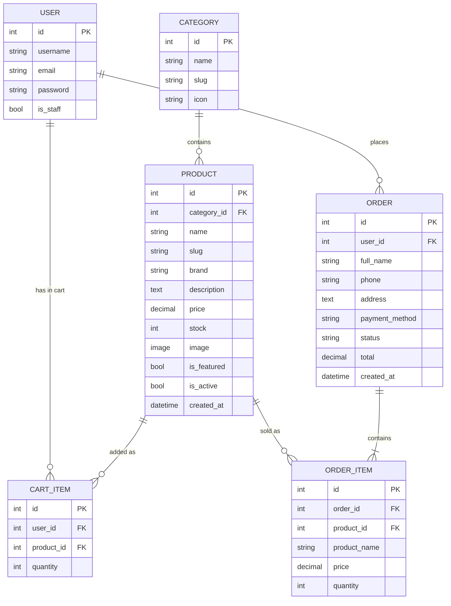

- `ORDER_ITEM` copies the product name and price at the time of purchase, so old orders stay correct if a product's price changes later.
- Order status flow: `pending → confirmed → shipped → delivered`, or `cancelled` (items go back to stock).

---

## REST API

Base URL: `http://127.0.0.1:8000/api/`

| Method | Endpoint | Who | Description |
|---|---|---|---|
| POST | `/api/auth/register/` | Anyone | Create an account, returns a token |
| POST | `/api/auth/login/` | Anyone | Log in, returns a token |
| GET | `/api/auth/me/` | Logged in | Current user |
| GET | `/api/categories/` | Anyone | List categories with product counts |
| POST/PUT/DELETE | `/api/categories/{id}/` | Admin | Manage categories |
| GET | `/api/products/` | Anyone | List products (`search`, `category`, `min_price`, `max_price`, `in_stock`, `ordering`) |
| GET | `/api/products/{slug}/` | Anyone | Product detail |
| POST/PUT/PATCH/DELETE | `/api/products/{slug}/` | Admin | Manage products |
| PATCH | `/api/products/{slug}/stock/` | Admin | Set stock level |
| GET | `/api/cart/` | Customer | Cart items, total and count |
| POST | `/api/cart/` | Customer | Add a product to the cart |
| PATCH | `/api/cart/{id}/` | Customer | Change quantity (0 removes) |
| DELETE | `/api/cart/{id}/` | Customer | Remove an item |
| DELETE | `/api/cart/clear/` | Customer | Empty the cart |
| GET | `/api/orders/` | Customer / Admin | Own orders (admin: all orders, `?status=`) |
| POST | `/api/orders/` | Customer | Checkout: cart → order (cash on delivery) |
| POST | `/api/orders/{id}/cancel/` | Customer | Cancel own pending order |
| PATCH | `/api/orders/{id}/status/` | Admin | Update order status |

Send the token in the header `Authorization: Token <your-token>`.

### Examples

**Register**
```bash
curl -X POST http://127.0.0.1:8000/api/auth/register/ \
  -H "Content-Type: application/json" \
  -d '{"username":"sokha","email":"sokha@example.com","password":"secret123"}'
```
```json
{
  "user": {"id": 3, "username": "sokha", "email": "sokha@example.com", "first_name": "", "last_name": "", "is_staff": false},
  "token": "c651bc058c604ae15de8a9c88e2d63b6de3b5301"
}
```

**Search and filter products**
```bash
curl "http://127.0.0.1:8000/api/products/?category=mice&ordering=price"
```
```json
{
  "count": 4,
  "next": null,
  "previous": null,
  "results": [
    {"id": 8, "name": "Travel Mini Mouse", "slug": "travel-mini-mouse", "brand": "Comfy", "price": "14.50", "stock": 0, "in_stock": false, "category": 2, "category_name": "Mice", "...": "..."},
    {"id": 5, "name": "Glide Wireless Mouse", "slug": "glide-wireless-mouse", "brand": "Quietly", "price": "19.90", "stock": 60, "in_stock": true, "category": 2, "category_name": "Mice", "...": "..."}
  ]
}
```

**Add to cart**
```bash
curl -X POST http://127.0.0.1:8000/api/cart/ \
  -H "Authorization: Token <your-token>" \
  -H "Content-Type: application/json" \
  -d '{"product_id": 5, "quantity": 2}'
```

**Checkout (cash on delivery)**
```bash
curl -X POST http://127.0.0.1:8000/api/orders/ \
  -H "Authorization: Token <your-token>" \
  -H "Content-Type: application/json" \
  -d '{"full_name":"Sok Sokha","phone":"012345678","address":"Phnom Penh"}'
```
```json
{
  "id": 2,
  "number": "TC-00002",
  "customer": "sokha",
  "full_name": "Sok Sokha",
  "phone": "012345678",
  "address": "Phnom Penh",
  "note": "",
  "payment_method": "cod",
  "status": "pending",
  "total": "39.80",
  "items": [
    {"id": 4, "product": 5, "product_name": "Glide Wireless Mouse", "price": "19.90", "quantity": 2, "subtotal": "39.80"}
  ],
  "created_at": "2026-11-11T12:37:06+07:00"
}
```

**Customer tries an admin action → blocked**
```bash
curl -X PATCH http://127.0.0.1:8000/api/orders/2/status/ \
  -H "Authorization: Token <customer-token>" \
  -H "Content-Type: application/json" -d '{"status":"shipped"}'
```
```json
{"detail": "You do not have permission to perform this action."}
```

**Admin updates order status**
```bash
curl -X PATCH http://127.0.0.1:8000/api/orders/2/status/ \
  -H "Authorization: Token <admin-token>" \
  -H "Content-Type: application/json" -d '{"status":"shipped"}'
```

---

## Screenshots

| | |
|---|---|
| **Product list: search, filter, sort** 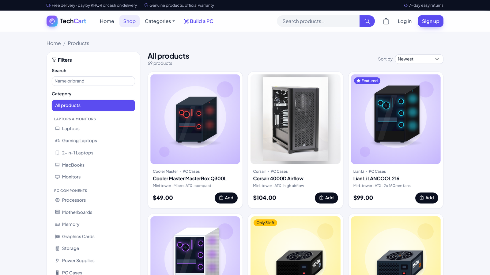 | **Product detail with specifications** 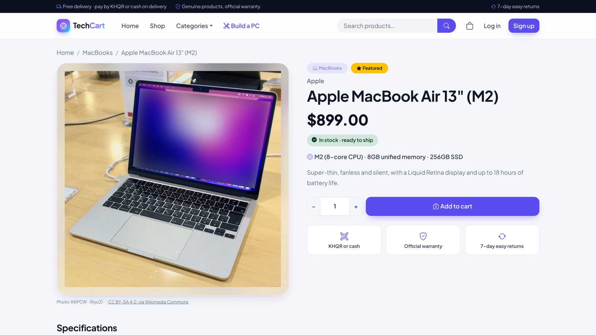 |
| **PC builder with compatibility checks** 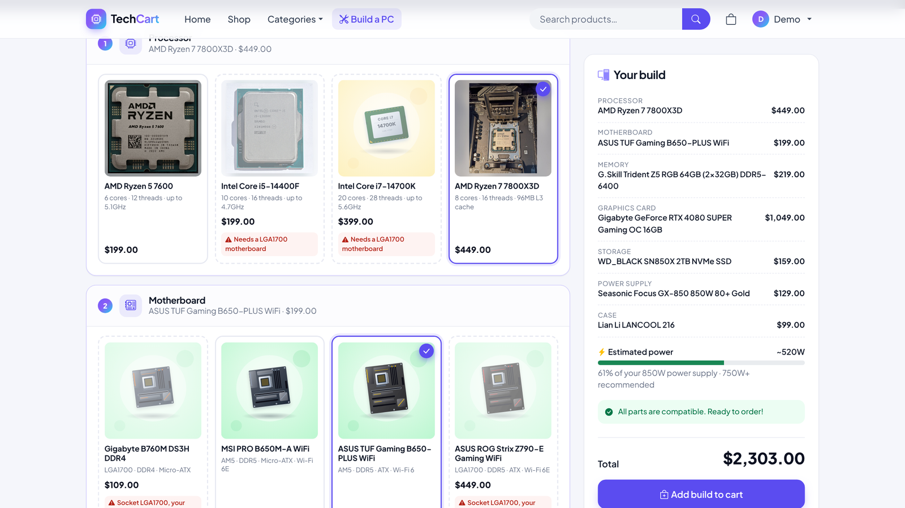 | **Cart** 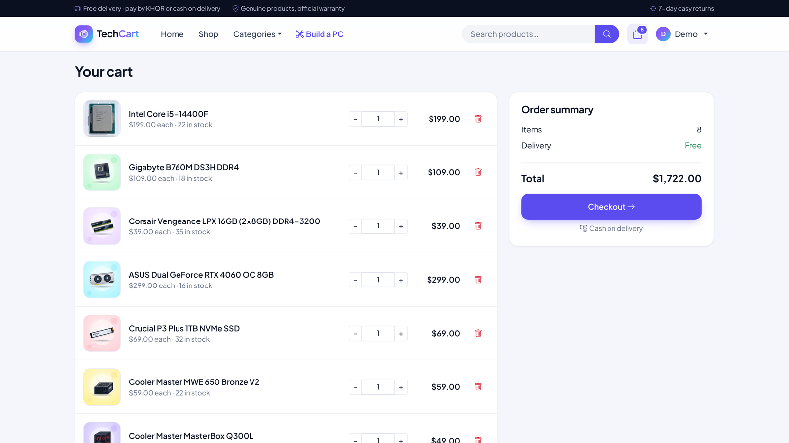 |
| **Checkout: KHQR or cash on delivery** 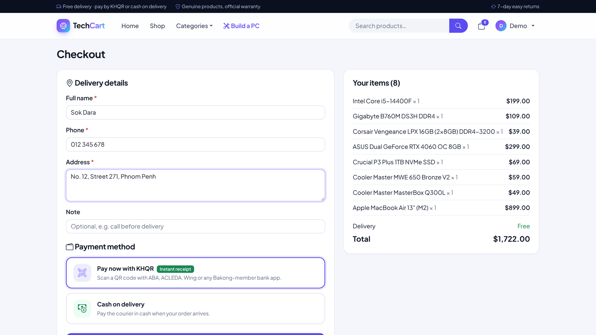 | **KHQR payment** 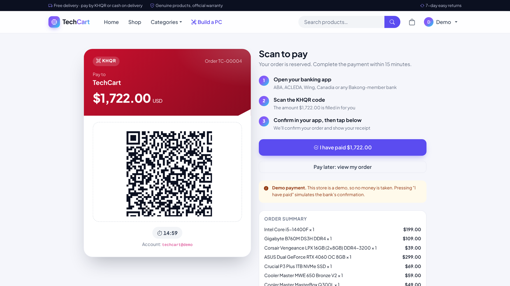 |
| **Printable receipt** 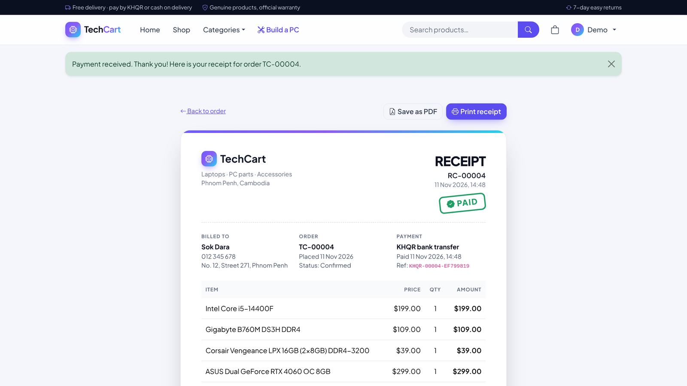 | **My orders** 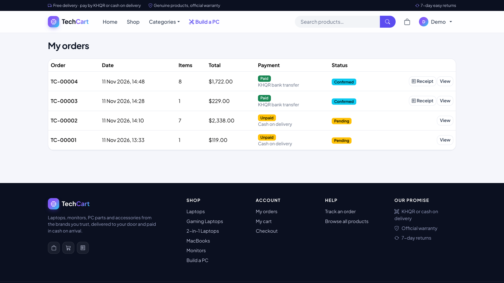 |
| **Admin dashboard** 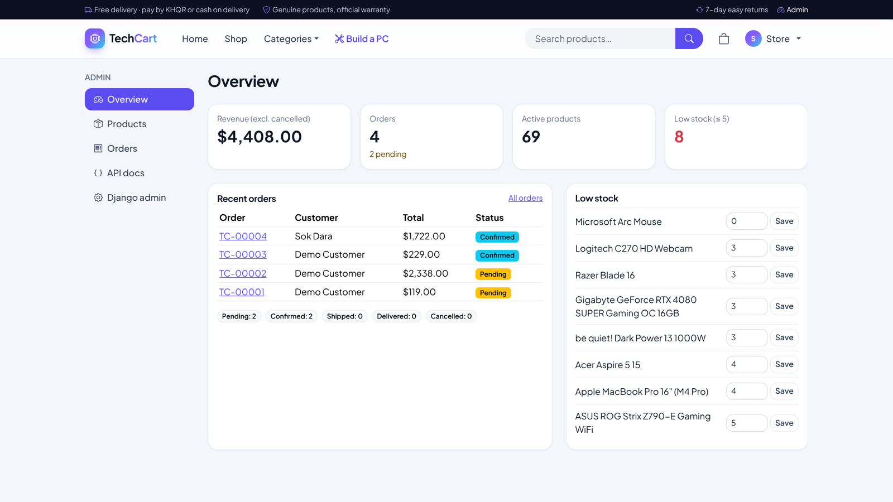 | **Admin: products and stock** 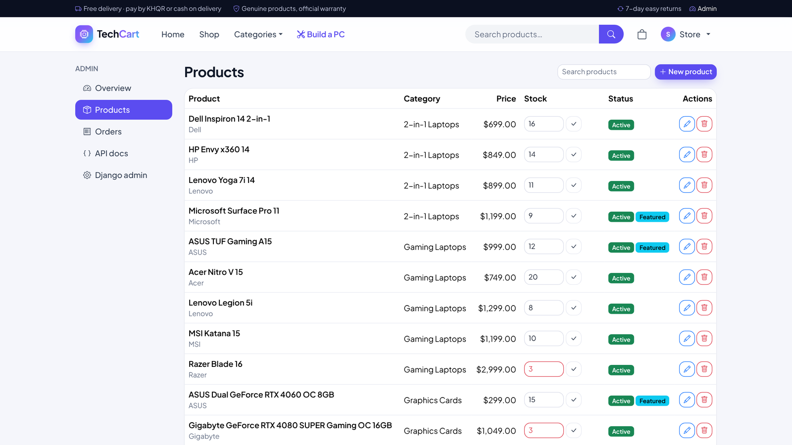 |
| **Admin: update order status** 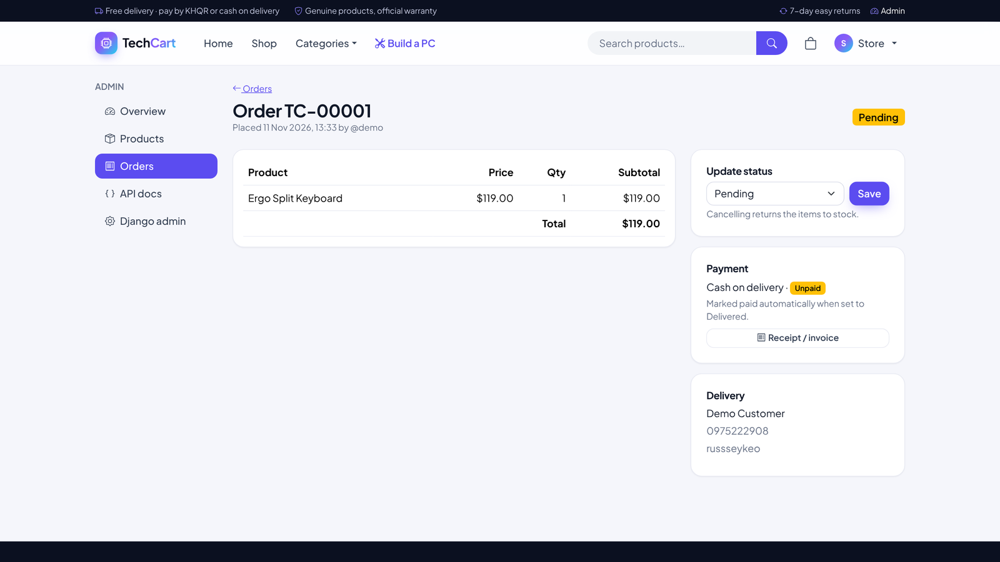 | **Browsable REST API** 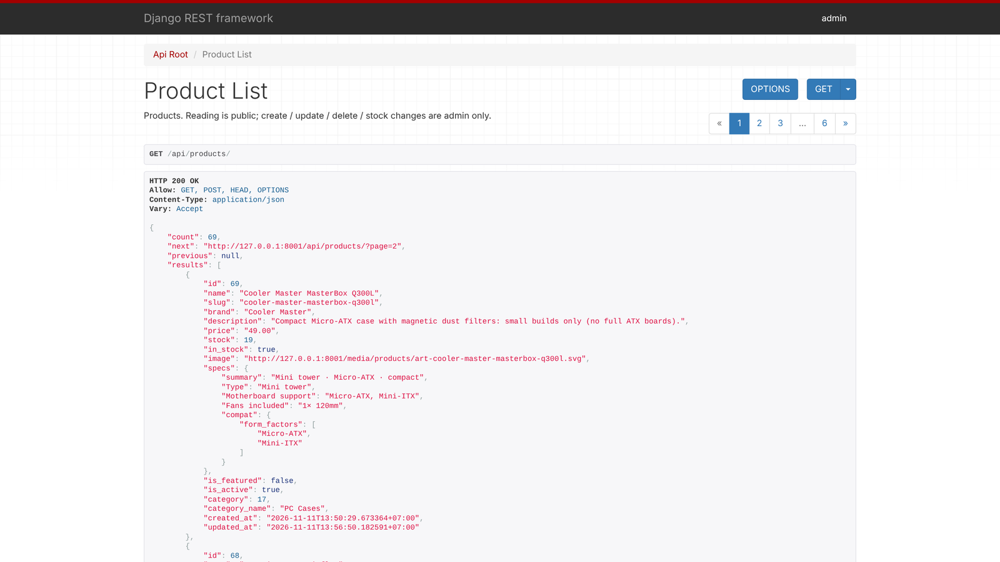 |
| **Login with demo accounts** 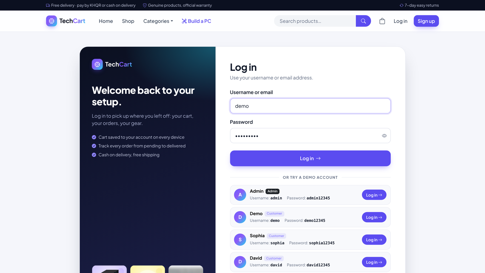 | **Mobile** <br>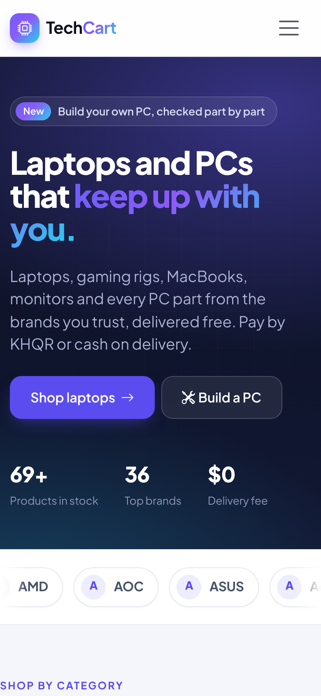 |

---

## Deploying to Vercel

The project is ready for [Vercel](https://vercel.com) (`vercel.json` uses the Python runtime with `config/wsgi.py`).

1. In Vercel, click **Add New → Project** and import this GitHub repository. Keep the default settings.
2. Optional environment variable: `DJANGO_SECRET_KEY` (any long random text).
3. Click **Deploy**. Every push to `main` deploys again automatically.

How it works on Vercel:
- Static files (CSS, JS, Bootstrap) are served by **WhiteNoise**; product photos in `media/products/` are served by Django.
- **Database:** add a free PostgreSQL database in Vercel (**Storage → Create Database → Neon**) and connect it to
  this project. Vercel then sets `DATABASE_URL`, and on its first start the site creates the tables and loads the
  demo data from `deploy/demo.sqlite3` (69 products and the demo accounts) — see `config/bootstrap.py`.
  Logins, carts and orders are then shared by every server instance and kept permanently.
- Without `DATABASE_URL`, each instance uses its own copy of the demo database in `/tmp` (Vercel's disk is
  read-only elsewhere). Logins still work (they are kept in a signed cookie), but carts, orders and new
  accounts disappear when Vercel recycles that instance.

---

## Notes

- Payment is KHQR (demo: no money moves) or cash on delivery, so no real payment gateway is needed.
- Product images are optional. Without an image, a coloured category tile is shown. Admins can upload real photos from the dashboard.
- For production, set the `DJANGO_SECRET_KEY`, `DJANGO_DEBUG=0` and `DJANGO_ALLOWED_HOSTS` environment variables.
